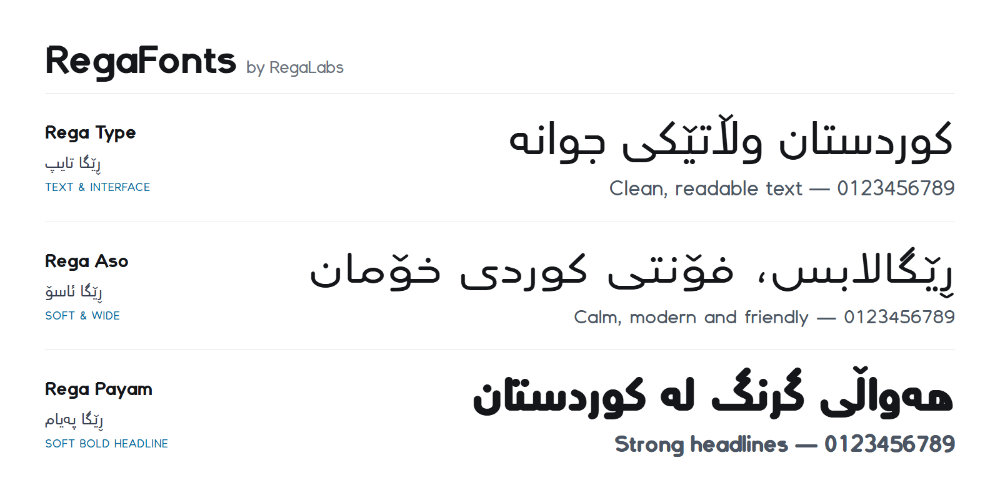

# RegaFonts

**Original Kurdish (Sorani), Arabic and Latin typefaces, designed and owned by [RegaLabs](https://regalabs.dev).**



Every letter in RegaFonts is drawn from code in this repository. Nothing is traced, copied or converted from another font.

---

## The Families

| Family | Kurdish name | Character | Best for | Weights |
| :--- | :--- | :--- | :--- | :--- |
| **Rega Type** | ڕێگا تایپ | Clean and even, tall letters, flat stroke ends | Body text, websites, apps, dashboards | Regular 400 · Bold 700 |
| **Rega Aso** | ڕێگا ئاسۆ | Soft and wide: low, wide letters, round stroke ends, soft corners | Brands, social media, calm modern interfaces | Light 300 · Regular 400 · Bold 700 |
| **Rega Payam** | ڕێگا پەیام | Soft and bold: a tall, full body, short tails, round stroke ends | Headlines, banners, posters | Regular 400 · Bold 700 |

## Features

- **Complete Kurdish Sorani**: every letter in every joining form, including ڕ ڵ ۆ ێ ە ھ ڤ پ چ ژ گ, and the لا ligatures.
- **Arabic**: Arabic letters, with vowel marks (harakat) that position themselves over and under each letter.
- **Numbers**: Kurdish digits ٠١٢٣٤٥٦٧٨٩ and English digits 0123456789, with Kurdish and English punctuation.
- **Latin**: A–Z, the Kurdish Latin letters ç ê î ş û, and the common accented letters.
- **Kerning**: every font is kerned from its own outlines, in Kurdish and in Latin.
- **Built for screens**: hinted TrueType for crisp small text on Windows, and WOFF2 for the web.
- **One line height**: all families share the same vertical metrics, so you can switch fonts without layouts moving.

361 glyphs per font.

---

## Using the Fonts

### On the web

Copy the `.woff2` files from [`fonts/woff2`](./fonts/woff2) into your project and add:

```css
/* Rega Type */
@font-face { font-family: 'Rega Type'; src: url('/fonts/Rega_Type-Regular.woff2') format('woff2'); font-weight: 400; font-display: swap; }
@font-face { font-family: 'Rega Type'; src: url('/fonts/Rega_Type-Bold.woff2') format('woff2'); font-weight: 700; font-display: swap; }

/* Rega Aso */
@font-face { font-family: 'Rega Aso'; src: url('/fonts/Rega_Aso-Light.woff2') format('woff2'); font-weight: 300; font-display: swap; }
@font-face { font-family: 'Rega Aso'; src: url('/fonts/Rega_Aso-Regular.woff2') format('woff2'); font-weight: 400; font-display: swap; }
@font-face { font-family: 'Rega Aso'; src: url('/fonts/Rega_Aso-Bold.woff2') format('woff2'); font-weight: 700; font-display: swap; }

/* Rega Payam */
@font-face { font-family: 'Rega Payam'; src: url('/fonts/Rega_Payam-Regular.woff2') format('woff2'); font-weight: 400; font-display: swap; }
@font-face { font-family: 'Rega Payam'; src: url('/fonts/Rega_Payam-Bold.woff2') format('woff2'); font-weight: 700; font-display: swap; }

body { font-family: 'Rega Type', system-ui, sans-serif; }
h1, h2 { font-family: 'Rega Payam', 'Rega Type', sans-serif; font-weight: 700; }
```

You can also load the files straight from this repository through the jsDelivr CDN:

```css
@font-face {
  font-family: 'Rega Type';
  src: url('https://cdn.jsdelivr.net/gh/RegaLabs/RegaFonts@main/fonts/woff2/Rega_Type-Regular.woff2') format('woff2');
  font-weight: 400;
  font-display: swap;
}
```

For production, replace `@main` with a commit hash so the files never change under your site.

> **Tip:** don't add `letter-spacing` to Kurdish or Arabic text. It pulls joined letters apart.

### On your computer

Install the `.ttf` files from [`fonts/ttf`](./fonts/ttf) (on Windows, right-click a file and choose **Install**). They show up in design apps as **Rega Type**, **Rega Aso** (with **Rega Aso Light**) and **Rega Payam**.

### Try them first

Open [`specimen.html`](./specimen.html) in a browser to type your own text in every family, size and weight.

---

## How the Fonts Are Made

The letters are drawn once, as centre lines (skeletons), in `glyphs.py` (Kurdish and Arabic), `latin.py` (Latin) and `signs.py` (digits, punctuation and symbols). Each family then writes those skeletons with its own pen and proportions, defined in `skeleton.py`:

| Family | Pen and proportions |
| :--- | :--- |
| Rega Type | Monoline with flat ends; verticals slightly thicker than horizontals, so the strokes look even |
| Rega Aso | Letters 84% as tall and 12% wider, tails 80% as deep; round stroke ends and dots, very soft corners |
| Rega Payam | Letters 110% as tall, shorter ascenders and tails, 6% narrower, heavy; round stroke ends; loops grow with the weight so counters stay open |

Proportions and width move the centre lines *before* they are stroked, so every stroke keeps an even weight. Round stroke ends stay flat wherever a stroke joins the next letter, so joins never pinch. `spacing.py` measures the finished outlines to place vowel marks and work out kerning, and `build.py` compiles everything into hinted TrueType and WOFF2.

### Building from source

Requires Python 3.10+.

```bash
pip install -r requirements.txt
python build.py                                    # every family and weight, into dist/ and fonts/
python build.py --family "Rega Aso" --weight Light # one font
python build.py out_dir --family "Rega Type"       # a trial build elsewhere (fonts/ is left alone)
python build.py --install path/to/app/fonts        # also copy the .woff2 files into an app
```

### Checking

```bash
python checks/shape_check.py                         # every Sorani letter in every joining form, لا, vowel marks
python checks/provenance.py <folder of other fonts>  # outlines identical to any other font: must be 0
```

---

## Project Structure

```
RegaFonts/
├── fonts/
│   ├── ttf/        Rega_<Family>-<Weight>.ttf   (and lowercase rega-<family>-<weight>.ttf)
│   └── woff2/      the same fonts as .woff2 for the web
├── dist/           the same files, as produced by build.py
├── docs/           images for this README
├── checks/         shaping test and originality (provenance) check
├── skeleton.py     the families: pens, proportions and width
├── glyphs.py       Kurdish and Arabic letters
├── latin.py        Latin letters and accents
├── signs.py        digits, punctuation and symbols
├── spacing.py      vowel-mark anchors and kerning, measured from the outlines
├── build.py        compiles the fonts
├── specimen.html   live specimen and text tester
└── LICENSE         RegaLabs font license
```

---

<div dir="rtl" align="right">

## بە کوردی

فۆنتەکانی ڕێگا کۆمەڵێک فۆنتی ڕەسەنی ڕێگالابسن بۆ کوردی (سۆرانی)، عەرەبی و لاتینی. هەموو پیتێک لەم کۆدەوە دروستکراوە و هیچ پیتێک لە فۆنتێکی ترەوە وەرنەگیراوە.

- **ڕێگا تایپ**: ڕوون و ڕێک، بۆ دەق، ماڵپەڕ و ئەپ
- **ڕێگا ئاسۆ**: نەرم و پان، بۆ براند و سۆشیال میدیا
- **ڕێگا پەیام**: نەرم و قورس، بۆ سەردێڕ، بانەر و پۆستەر

هەموو پیتە کوردییەکان بە هەموو شێوەکانی لکاندنەوە، ژمارەی کوردی و ئینگلیزی، و پیتی لاتینی تێدایە.

</div>

---

## License

Copyright © 2026 RegaLabs. All rights reserved.

The fonts may be used for digital displays, applications and websites affiliated with RegaLabs and its authorized partners. See [`LICENSE`](./LICENSE) for the full terms, and contact [RegaLabs](https://regalabs.dev) for any other use.

**RegaFonts** is designed, built and maintained by [RegaLabs](https://regalabs.dev).
